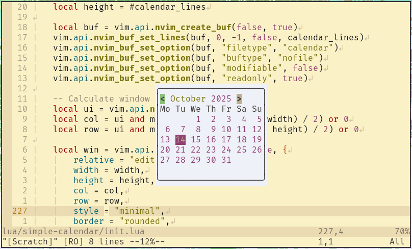

# simple-calendar.nvim

A simple calendar plugin for Neovim.



## Features

- Intuitive navigation using h/j/k/l keys
- Additional Vim-style navigation keys (b/w/e/ge) and arrow keys
- Month switching using p/n keys (and `<C-D>`/`<C-U>` alternatives)
- Date selection that opens files based on configurable pattern

## Installation

Using [lazy.nvim](https://github.com/folke/lazy.nvim):

```lua
{ "yahorni/simple-calendar.nvim" }
```

## Usage

```lua
require('simple-calendar').open()                       -- today's calendar
require('simple-calendar').open({ year = 2025, month = 1, day = 15 })
```

`open()` shows the date parsed from the current filename when it matches `daily_path_pattern` (e.g. `2024-10-15.md`), or the week when it matches `weekly_path_pattern` (e.g. `2025-W03.md`) — focused on today when it's the current week, otherwise on that week's Thursday; otherwise the current date. The optional `date` argument is a table with `year`, `month`, `day` fields.

Keymaps:

```lua
local calendar = require("simple-calendar")

-- calendar
vim.keymap.set('n', '<leader>c', calendar.open, { desc = "Open [C]alendar" })

-- journaling
vim.keymap.set("n", "<leader>d", calendar.journal, { noremap = true, desc = "Open [d]aily note" })
vim.keymap.set("n", "<leader>t", function() calendar.journal("tomorrow") end,
               { noremap = true, desc = "Open [t]omorrow's daily note" })
vim.keymap.set("n", "<leader>y", function() calendar.journal("yesterday") end,
               { noremap = true, desc = "Open [y]esterday's daily note" })
vim.keymap.set("n", "<leader>n", function() calendar.journal("next") end,
               { noremap = true, desc = "Open [n]ext daily note" })
vim.keymap.set("n", "<leader>p", function() calendar.journal("previous") end,
               { noremap = true, desc = "Open [p]revious daily note" })
```

## Keybindings

When the calendar window is open:

Key            | Action
---            | ---
`h`, `<Left>`  | Move left to previous day
`j`, `<Down>`  | Move down to next week
`k`, `<Up>`    | Move up to previous week
`l`, `<Right>` | Move right to next day
`b`, `ge`      | Move left to previous day
`w`, `e`       | Move right to next day
`p`, `<C-D>`   | Switch to previous month
`n`, `<C-U>`   | Switch to next month
`o`, `<CR>`    | Select current date and open corresponding file
`O`            | Open the weekly note for the currently selected day's week
`t`            | Jump to today's date
`q`, `<Esc>`   | Close calendar window

## Configuration

No configuration required. To customize, provide a configuration table:

```lua
require("simple-calendar").setup({
    daily_path_pattern = "",              -- empty by default
    weekly_path_pattern = "",             -- empty by default
    show_week_number = false,
    use_lowercase_paths = false,
    highlight_unfinished_tasks = false,
    completed_task_markers = {"x", "-"},
    skip_weekends = false,
})
```

Option                       | Type    | Default      | Description
---                          | ---     | ---          | ---
`daily_path_pattern`         | string  | `""`         | strftime pattern for daily note paths. Required for date selection and `journal()`.
`weekly_path_pattern`        | string  | `""`         | strftime pattern for weekly note paths. Required for `weekly()` and the `O` key.
`show_week_number`           | boolean | `false`      | Show ISO week numbers in a gutter column (`W` header label + `|` separator).
`use_lowercase_paths`        | boolean | `false`      | Generate daily and weekly note paths in lowercase. Matching is exact.
`highlight_unfinished_tasks` | boolean | `false`      | Highlight days with unfinished markdown tasks with the `Todo` group.
`completed_task_markers`     | table   | `{"x", "-"}` | Single-character markers inside brackets that count a task as completed.
`skip_weekends`              | boolean | `false`      | Skip weekends in `journal()` (see below).

### Path patterns

Supported strftime tokens:

- `%Y` - 4-digit year (e.g. 2024)
- `%m` - 2-digit month (e.g. 10)
- `%d` - 2-digit day (e.g. 15)
- `%B` - Full month name (e.g. October)
- `%b` - Month abbreviation (e.g. Oct)
- `%A` - Full weekday name (e.g. Tuesday)
- `%a` - Weekday abbreviation (e.g. Tue)

Directory structures with date components are supported:

- `%Y-%m-%d.md` → `2024-10-15.md`
- `%Y-%m %B/%Y-%m-%d.md` → `2024-10 October/2024-10-15.md`
- `notes/%Y/%m-%B/%Y-%m-%d.md` → `notes/2024/10-October/2024-10-15.md`

Weekday tokens (`%a`, `%A`) are validated against the extracted date; a mismatch means the filename is not recognized.

With `use_lowercase_paths = true`, paths are generated in lowercase (`feb-25-2026-wed.md`); otherwise the `os.date()` casing is used (`Feb-25-2026-Wed.md`). Matching is exact.

Weekly patterns additionally support:

- `%G` - ISO week-year (e.g. 2025)
- `%g` - 2-digit ISO week-year (e.g. 25; `00`-`49` → `20xx`, `50`-`99` → `19xx`)
- `%V` - ISO week number, Monday-first, `01`..`53`

Pair `%V` with `%G`: `%G-W%V.md` → `2025-W03.md`. Using `%V` with `%Y` (calendar year) can produce mismatches across the new-year boundary (Jan 1-3 may belong to the previous ISO year). `%V` without `%G`/`%g` — or a pattern with no resolvable week tokens at all — logs a warning at `setup()` and makes `weekly("next"/"previous")` report the week as unresolvable.

### Day highlighting

Today's cell is always underlined (`CalendarToday` highlight group, customize via `:hi CalendarToday …`), regardless of `daily_path_pattern`.

When `daily_path_pattern` is set, days are also highlighted by status:

- **Existing note** → bold (`CalendarDayWithNote` highlight group)
- **Missing file** → dimmed (`Comment` highlight group)
- **Unfinished tasks** (`- [ ]`, `* [ ]`, `+ [ ]`) → `Todo` highlight group (requires `highlight_unfinished_tasks`)
- Days with only completed tasks are shown as normal note days (bold)

`completed_task_markers` controls which bracket contents mark a task as completed. Markers must be single characters (e.g. `"x"`, `"✓"`, `"✅"`); matching is exact - spaces in brackets are not trimmed.

### Skip weekends

When `true`, `journal()` skips Saturdays and Sundays:

- On Friday, `"tomorrow"` opens Monday's file
- On Monday, `"yesterday"` opens Friday's file
- On Saturday, `"tomorrow"` opens Monday's file
- On Sunday, `"yesterday"` opens Friday's file

### Using with lazy.nvim

The plugin is lazy-loading friendly and works well with lazy.nvim's `keys` and `opts` fields:

```lua
{
  "yahorni/simple-calendar.nvim",
  opts = {
    daily_path_pattern = "%b-%d-%Y-%a.md",
    use_lowercase_paths = true,
  },
  keys = {
    { "<leader>co",
      function() require("simple-calendar").open() end,
      { noremap = true, desc = "Open calendar" } },
    { "<leader>cj",
      function() require("simple-calendar").journal() end,
      { noremap = true, desc = "Open today's journal" } },
  },
}
```

## Journaling

Requires `daily_path_pattern`. `journal([arg])` opens the note for:

- `"today"`, `nil` or omitted → today
- `"yesterday"` / `"tomorrow"` → yesterday / tomorrow
- `"next"` / `"previous"` → the day after / before the currently open daily note (must match `daily_path_pattern`; respects `skip_weekends`)
- `{ year = Y, month = M, day = D }` → that date

Other strings display an error. Missing files prompt to create.

```lua
local calendar = require("simple-calendar")
calendar.journal()                          -- today
calendar.journal("tomorrow")                -- tomorrow
calendar.journal({ year = 2025, month = 1, day = 15 })
```

User command:

```lua
vim.api.nvim_create_user_command("Journal", calendar.journal, { nargs = "?" })
```

```bash
nvim -c 'Journal'
nvim -c 'Journal tomorrow'
nvim -c 'lua require("simple-calendar").journal()'
```

## Weekly notes

Requires `weekly_path_pattern`. `weekly([arg])` opens the note for the week anchored at its Monday:

- `"today"`, `nil` or omitted → the week containing today
- `"next"` / `"previous"` → the week after / before the currently open weekly note (must match `weekly_path_pattern`)
- `"from_daily"` → the week of the currently open daily note (must match `daily_path_pattern`)
- `{ year = Y, month = M, day = D }` → that date's week

An empty string is treated as `"today"` (this is what `:Weekly` with no argument passes). If the pattern cannot resolve a week, or the filename contains an invalid ISO week (e.g. week 53 in a 52-week year), a specific error is shown. Missing files prompt to create.

```lua
local calendar = require("simple-calendar")
calendar.weekly()                          -- this week
calendar.weekly("next")                    -- next week
calendar.weekly("from_daily")              -- week of the open daily note
```

User command:

```lua
vim.api.nvim_create_user_command("Weekly", calendar.weekly, { nargs = "?" })
```

```bash
nvim -c 'Weekly'
nvim -c 'Weekly next'
```

## Testing

Run the tests:

```bash
nvim --headless -u tests/runner.lua
```

## License

MIT License
